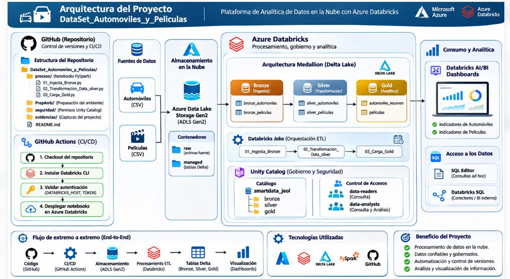

# Evidencias del Proyecto
 

Este apartado presenta las evidencias de implementación del proyecto de Ingeniería de Datos desarrollado en Azure Databricks, utilizando arquitectura Medallion, Delta Lake, Unity Catalog, GitHub Actions y dashboards analíticos.

---

## 01. Almacenamiento en Azure
Implementación del almacenamiento de datos mediante Azure Data Lake Storage Gen2.

## 02. Contenedores de almacenamiento
Configuración de los contenedores para almacenar los archivos fuente y las tablas administradas.

## 03. Unity Catalog
Implementación del catálogo de datos y organización de los esquemas Bronze, Silver y Gold.

## 04. Capa Bronze
Ingesta de archivos fuente y almacenamiento inicial en tablas Delta.

## 05. Capa Silver
Transformación, limpieza y preparación de los datos.

## 06. Capa Gold
Generación de tablas analíticas para el consumo de información.

## 07. Notebooks de procesamiento
Desarrollo de notebooks PySpark para las diferentes capas de la arquitectura Medallion.

## 08. Job ETL
Configuración del Job de Databricks para ejecutar los procesos Bronze, Silver y Gold.

## 09. Ejecución del proceso ETL
Evidencia de la ejecución satisfactoria del flujo de procesamiento.

## 10. Grupos de seguridad
Creación de los grupos data-readers y data-analysts en Databricks.

## 11. Permisos en Unity Catalog
Configuración de privilegios de acceso a los datos mediante sentencias GRANT.

## 12. Integración continua y despliegue continuo
Configuración del workflow de GitHub Actions para automatizar el despliegue.

## 13. Despliegue en Databricks
Evidencia del despliegue de notebooks desde GitHub hacia Azure Databricks.

## 14. Dashboard analítico
Implementación de indicadores y visualizaciones mediante Databricks AI/BI Dashboards.

## 15. Dashboard publicado
Publicación del dashboard interactivo para el análisis de automóviles y películas.

---

## 16. Arquitectura del Proyecto

Diagrama de arquitectura tecnológica End-to-End del proyecto
DataSet_Automoviles_y_Peliculas, desarrollado en Microsoft Azure
y Azure Databricks.
 

## Tecnologías utilizadas

- Microsoft Azure
- Azure Data Lake Storage Gen2
- Azure Databricks
- Apache Spark / PySpark
- Delta Lake
- Unity Catalog
- GitHub Actions
- Databricks AI/BI Dashboards
